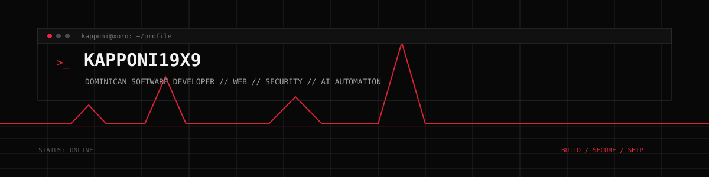
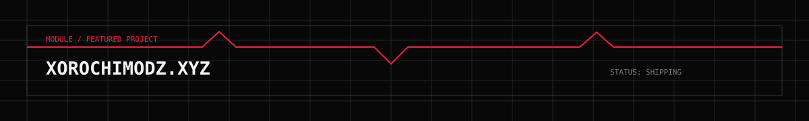
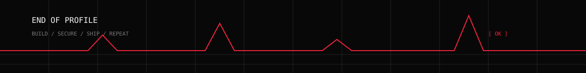

<div align="center">
  
</div>

<div align="center">
  <a href="https://github.com/AlkapoOneConet"></a>
  <a href="https://github.com/AlkapoOneConet?tab=repositories"></a>
  <a href="https://xorochimodz.xyz"></a>
</div>

## About me

I’m **Kapponi19X9**, a **Dominican software developer** building useful, maintainable and secure digital products from the Dominican Republic for the global developer community.

My work sits at the intersection of **web engineering, application development, cybersecurity diagnostics, authorized penetration testing and AI-powered automation**. I like systems that are clear under the hood, intentional in the interface and responsible in production. I usually start by understanding the problem, then design, build, validate and improve the solution.

Based in the **Dominican Republic 🇩🇴**, I’m interested in collaborating with people who care about useful products, thoughtful engineering and continuous learning.

## What I do

| Area | What I do |
| --- | --- |
| **Web engineering** | Full-stack interfaces, responsive products, REST APIs and performance-minded builds |
| **App development** | Android experiences, integrations and user-centered application flows |
| **Cybersecurity** | OWASP practices, secure coding, attack-surface review and vulnerability assessment |
| **Pentesting diagnostics** | Authorized testing, reproducible findings, risk context and remediation guidance |
| **AI automation** | AI APIs, scripts, agents and workflows that reduce repetitive work |
| **Product engineering** | Technical decisions, documentation, version control and maintainable delivery |

## How I can help

I’m interested in practical projects where software needs to be useful, reliable and easy to improve over time.

- **Websites and platforms:** from a focused landing page to a complete community or product experience.
- **Application prototypes:** turning an idea into a working web or Android application.
- **Automation:** connecting APIs, scripts and AI tools to remove repetitive steps from a workflow.
- **Technical reviews:** identifying configuration issues, weak points and opportunities to improve maintainability.
- **Security-minded development:** applying safer defaults, clear boundaries and responsible testing from the beginning.

## How I work

1. **Understand the goal** — define the user, the problem and the result that matters.
2. **Plan the structure** — choose the simplest architecture that can support the next stage.
3. **Build in iterations** — keep changes focused, reviewable and easy to test.
4. **Validate the details** — check behavior, performance, security considerations and usability.
5. **Document the outcome** — leave behind code and decisions that another person can understand.

I value direct communication, realistic scope and steady progress over unnecessary complexity.

## Technologies I use

<div align="center">
  
  <br /><br />
  
</div>

<p align="center">
  
  
  
  
  
</p>

## Engineering standards

```text
Readable code        over clever code
Small iterations     over risky rewrites
Documented decisions over hidden assumptions
Secure defaults      over last-minute fixes
Useful features      over empty complexity
```

For security work, I only test systems I own or systems where the scope and authorization are clear. Findings should be reproducible, responsibly reported and connected to a practical mitigation.

<div align="center">
  
</div>

## Featured project

### [XorochiModz](https://xorochimodz.xyz)

A community-oriented digital project focused on **visual identity, useful functionality and continuous iteration**.

<a href="https://xorochimodz.xyz"></a>

The project represents the kind of work I enjoy: a clear identity, a real audience, room to experiment and a product that can keep evolving instead of being treated as a one-off page.

## What I’m learning next

- Improving backend architecture and API design.
- Deepening application-security and secure-delivery practices.
- Building more useful AI-assisted developer workflows.
- Writing better documentation and sharing more complete project case studies.

## Current focus

- Building web platforms, applications and internal tools.
- Developing AI-assisted automations and API integrations.
- Studying application security, backend architecture and secure delivery.
- Working on authorized security diagnostics with defined scope and responsible disclosure.
- Improving through real projects, documentation and deliberate iteration.

## Collaboration

If you are building a website, application, automation or technical project, send me a message with the context, what you want to achieve and where you are currently blocked. I prefer conversations that begin with the problem rather than a list of tools.

## GitHub activity

<div align="center">
  
  
</div>

<div align="center">
  
</div>

## Let’s connect

- **Discord:** [@k0vzx](https://discord.com/users/k0vzx)
- **Portfolio:** [xorochimodz.xyz](https://xorochimodz.xyz)
- **GitHub:** [@AlkapoOneConet](https://github.com/AlkapoOneConet)

> **Dominican Republic 🇩🇴 · building for the world.**

<div align="center">
  
</div>
